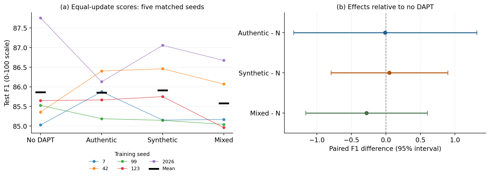

<div align="center">

# ⚖️ Target-Oriented Pretraining for Statutory QA

### Domain-Adaptive Pretraining for Statutory Question Answering: Evidence from Authentic, Synthetic, and Mixed Legal Text

[](#quick-start)
[](#research-at-a-glance)
[](#research-question)
[](#dataset-and-scope)
[](#repository-guide)
[](papers/target_pretraining/target-pretraining.pdf)
[](https://huggingface.co/datasets/niloycste68/IndicIPRExtractiveQA)

**M. Mohaiminul Islam** · **Muhammad Abulaish**<br>
Department of Computer Science and Engineering, South Asian University, New Delhi, India

[Quick start](#quick-start) · [Results](#research-at-a-glance) · [Reproduce](#reproduce-the-reported-results) · [Paper](papers/target_pretraining/target-pretraining.pdf) · [Citation](#citation)

</div>

---

## ✨ Why this repository matters

Domain-adaptive pretraining (DAPT) exposes an encoder to additional in-domain
text before task fine-tuning. For statutory extractive question answering, this
may improve language-model fit without improving the final answer span.

> [!IMPORTANT]
> **Core idea:** better masked-language-model fit is not, by itself, evidence
> of better downstream statutory question answering.

This repository accompanies a controlled study of that question on IndicIPR-QA.
It compares an InLegalBERT reader with no additional DAPT against readers
adapted on authentic statutes, task-informed synthetic legal text, and a mixed
corpus. The main comparison holds the optimization schedule fixed, uses five
training seeds, and reports both masked-language-model diagnostics and
downstream answer quality.

```text
Legal encoder → optional statutory DAPT → SQuAD transfer → IndicIPR-QA fine-tuning
                       ↓                                      ↓
              MLM fit diagnostics                       EM / token F1
```

The goal is not to claim that DAPT never helps. It is to test, under a fixed
benchmark, encoder, corpus construction, and short adaptation budget, whether
these additional text sources reliably improve statutory answer extraction.

## 📊 Research at a glance

| Equal-update condition | Mean test F1 across five seeds | Difference from no DAPT |
|---|---:|---:|
| No additional DAPT | **85.86 ± 1.08** | — |
| Authentic statutory text | **85.85 ± 0.46** | −0.01 [−1.34, 1.32] |
| Task-informed synthetic text | **85.91 ± 0.84** | +0.05 [−0.80, 0.90] |
| Mixed authentic + synthetic text | **85.58 ± 0.75** | −0.28 [−1.16, 0.60] |

> [!TIP]
> **Headline result:** under equal update counts and five training seeds, none
> of the tested DAPT corpora shows a reliable F1 improvement over the
> no-additional-DAPT condition on this benchmark.

The seed-blocked condition test gives **p = 0.706**. Every paired 95% interval
against no DAPT includes zero. Therefore, this comparison does not detect a
reliable DAPT benefit on the 344-question test set. An earlier three-epoch
sensitivity comparison, despite unequal update counts, shows the same general
pattern. MLM fit can improve without a matching extractive-QA gain.

<p align="center">
  
</p>

<p align="center"><em>Equal-update comparison across five training seeds. See the paper for the statistical design and limitations.</em></p>

## 🎯 Research question

The project addresses three related questions:

1. Does additional statutory DAPT improve extractive QA over a legal-domain encoder?
2. With equal optimizer updates, do authentic, synthetic, and mixed corpora differ from no additional DAPT?
3. Do masked-language-model improvements or reduced labelled supervision reveal an extraction benefit that average QA scores conceal?

The reported answer is limited to the tested setting. The study does not claim
equivalence between conditions, generalize to all legal tasks, or establish that
DAPT cannot help other models, domains, data budgets, or training schedules.

## 🗂️ Dataset and scope

| Item | Value |
|---|---:|
| Question-answer pairs | **4,462** |
| Paragraph-level statutory contexts | **1,116** |
| Statutes | **7 Indian IPR Acts** |
| Train / validation / test questions | **3,710 / 408 / 344** |
| Main equal-update conditions | **4** |
| Training seeds per main condition | **5** |

> [!NOTE]
> **Dataset:** [IndicIPRExtractiveQA on Hugging Face](https://huggingface.co/datasets/niloycste68/IndicIPRExtractiveQA) · [`niloycste68/IndicIPRExtractiveQA`](https://huggingface.co/datasets/niloycste68/IndicIPRExtractiveQA)

IndicIPR-QA contains generated and curated English extractive questions. The
experiments study gold-context reading, rather than open retrieval. The separate
retrieval and source-selection diagnosis is released in its own repository.

## 🚀 Quick start

Run the commands from the repository root.

```powershell
git clone https://github.com/niloycste/Target-Oriented-Pretraining-on-IPR-Statute.git
Set-Location Target-Oriented-Pretraining-on-IPR-Statute
py -3.12 -m venv .venv
.\.venv\Scripts\Activate.ps1
python -m pip install --upgrade pip
pip install -r requirements.txt
```

On Linux or macOS, activate with `source .venv/bin/activate`.

## 🔬 Reproduce the reported results

Choose the smallest path that answers your question.

| Reproduction level | Command | Requires checkpoints? | What it checks or produces |
|---|---|:---:|---|
| Release integrity | `python verify_release.py` | No | Required files, test size, and equal-update headline values |
| Saved-result analysis | Commands below | No | Statistics from saved predictions and ledgers |
| Figure regeneration | `make_final_dapt_figures.py` | No | Figures from versioned outputs |
| Full evidence audit | Audit scripts | Yes | Checkpoint fingerprints and telemetry |
| Full training rerun | `run_full_study.py` | Yes | DAPT, transfer, fine-tuning, and evaluation |

### 1. Verify the release

```powershell
python verify_release.py
python scripts/09_dapt_final/analyse_final_experiments.py
python scripts/dapt_equal_update/analyse_experiment_d.py
```

These scripts reanalyse the saved results. They do not retrain models.

### 2. Regenerate the figures

```powershell
python scripts/08_figures/make_final_dapt_figures.py
```

The final manuscript figures are stored in
`papers/target_pretraining/plots/`.

### 3. Audit or rerun the full study

Full evidence audits require the non-versioned checkpoints under
`artifacts/models/` because they compare checkpoint fingerprints and training
telemetry. Full DAPT and QA fine-tuning also require substantial compute and
downloads of public Hugging Face base models.

```powershell
python scripts/09_dapt_final/write_dry_run_report.py
python scripts/09_dapt_final/run_full_study.py --help
```

Review `docs/DAPT_EXPERIMENT_PROTOCOL.md` before launching the full pipeline.

## 🧭 Repository guide

```text
.
├── artifacts/models/                 # Tokenizer metadata and training telemetry; weights excluded
├── data/
│   ├── processed/indic_ipr_qa/        # Released statutory QA corpus
│   ├── splits/                        # Fixed train, validation, and test splits
│   └── dapt/                          # Archived DAPT corpora
├── docs/                              # Protocol, provenance, and project-split records
├── experiments/dapt/
│   ├── final_cpu/                     # Final corpora, predictions, and statistics
│   └── equal_update/                  # Five-seed equal-update experiment evidence
├── papers/target_pretraining/         # LaTeX source, bibliography, figures, and PDF
├── results/                           # Archived reader, MLM, and matched-corpus evidence
├── scripts/
│   ├── 09_dapt_final/                 # Final experiment and audit pipeline
│   ├── dapt_equal_update/              # Equal-update analysis and audit
│   ├── 05_size_matched_dapt/           # Archived matched-corpus controls
│   └── 08_figures/                     # Figure generators
├── requirements.txt                    # Pinned Python environment
└── verify_release.py                   # Fast release-integrity check
```

`docs/RESULT_PROVENANCE.md` maps manuscript claims to retained artifacts.
`ARTIFACT_MANIFEST.md` describes this release and its exclusions.

## ✍️ Citation

If you use this repository, its experiments, or the target-oriented DAPT
evaluation framework, please cite the accompanying paper:

```bibtex
@misc{islam_abulaish_2026_target_oriented_dapt,
  author = {Islam, M. Mohaiminul and Abulaish, Muhammad},
  title = {Domain-Adaptive Pretraining for Statutory Question Answering:
           Evidence from Authentic, Synthetic, and Mixed Legal Text},
  year = {2026},
  note = {Manuscript and reproducibility artifacts},
  url = {https://github.com/niloycste/Target-Oriented-Pretraining-on-IPR-Statute}
}
```

For the benchmark itself, cite the separate IndicIPR-QA dataset/resource paper
once its proceedings record is available.

---

<div align="center">

**Domain-adaptive pretraining · Statutory QA · Synthetic legal text · Legal NLP**

</div>
